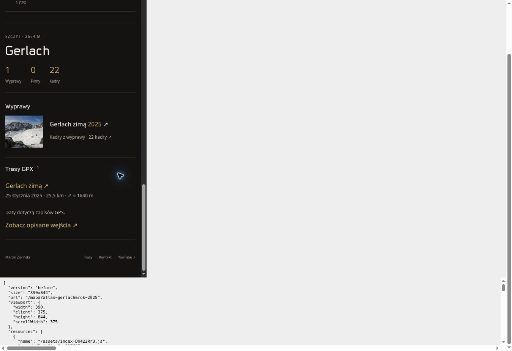
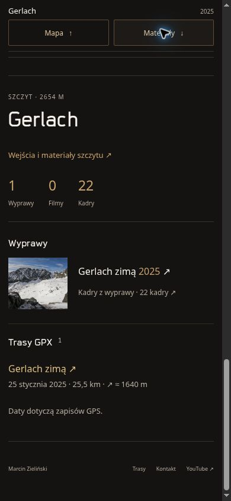
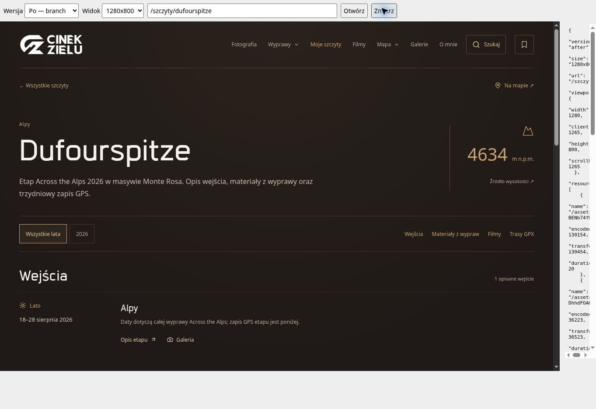
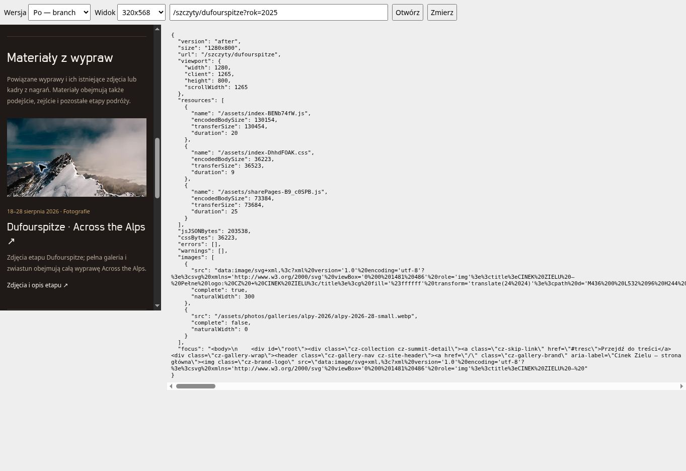
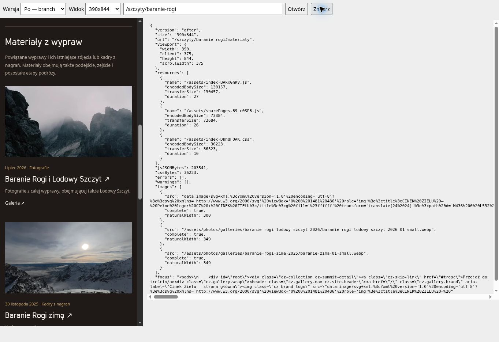

# Atlas i trzy strony szczytów — pakiet do przeglądu

24 października 2026. Gałąź `codex/atlas-summit-pages`, baza aktualnego `main`: `6ff7295f9210003787e36adf1e5092bcab191a26` (PR184). Implementacja i kontrole wykonane w chmurze. Nie scalono zmian, nie wdrożono produkcji. Nowy pakiet jest niezależny od draft PR185.

## Gotowy zakres

1. **Gerlach, Baranie Rogi, Dufourspitze:** `/szczyty/gerlach`, `/szczyty/baranie-rogi`, `/szczyty/dufourspitze`. Każda strona łączy istniejący rejestr wejść, wysokość ze źródłem, powiązane materiały i odnośniki do istniejących map/profili GPX. Ma wybór roku, sekcje, statyczny HTML, canonical, sitemap i obraz udostępniania z repozytorium. Dostęp z atlasu, listy szczytów i wyszukiwarki; wyszukiwarka zachowuje osobny link „Na mapie”.
2. **Atlas na telefonie:** pasek bieżącego miejsca/roku i przyciski Mapa / Materiały. Przejście w obie strony jest natychmiastowe i nie odmontowuje mapy, nie zmienia kadru ani wpisu historii. Powrót trafia fokusem do sterowanej klawiaturą powierzchni mapy. Po wejściu do panelu pierwszy Tab odsłania dodatkowy powrót do mapy.
3. **Tatry / Alpy → GPX:** panel regionu pokazuje maksymalnie trzy istniejące ślady oraz link „Zobacz trasy tego regionu” z filtrem pasma i roku. „Wybrane trasy GPX” celowo nie udaje pełnego spisu: punkty atlasu mają przypięte 27 tatrzańskich / 8 alpejskich śladów, a katalog zawiera odpowiednio 29 / 11.
4. **Powrót z zachowaniem kontekstu:** nowe strony korzystają z istniejącego BrowseReturn. Powrót do atlasu zachowuje pełny adres (rok, kadr, podkład); do listy — zapytanie, filtry, pozycję i fokus. Bez wcześniejszego kontekstu działają zwykłe linki do mapy/listy z rokiem. Hash szczytu jest dodawany tylko wtedy, gdy wiersz istnieje w tym roku. Etykieta powrotu ze strony szczegółowej brzmi „Wróć do szczytu”.

## Materiały i granice

Nie dodano szczytów, wejść, wypraw, GPX ani zdjęć. Pozostaje 43 istniejących szczytów. Strony mają po 1 / 2 / 1 istniejącej miniaturze materiałów, wszystkie ładowane lazy; bez osadzania kolejnego atlasu ani pobierania pełnych śladów GPX. Rozmiary responsywnych zdjęć odpowiadają szerokości kart na telefonie i komputerze.

Gerlach 2024 pozostaje wejściem potwierdzonym GPS z nieopisanym sezonem. Dufourspitze zachowuje daty całej wyprawy 18–28 sierpnia 2026, a daty trzydniowego zapisu są oddzielnie. Zdjęcia Dufourspitze prowadzą do istniejącego etapu; zwiastun jest oznaczony jako materiał całej wyprawy. Baranie Rogi rozróżniają fotografie letniej wyprawy obejmującej także Lodowy Szczyt i zimowe kadry z nagrań. Nie ma nowej galerii ani powielenia zdjęć pod profilem.

Bez zmian: premium galerie, ujednolicone zdjęcia etapów PR184, logo, czcionki, ogólny układ, Vercel, zależności, `sources`, AGENTS, dane tras, Zapisane i nieopublikowane dodatki z laptopa. Rumunia bez nowych zmian. Nie korzystano z laptopa ani prywatnych materiałów.

## Przed / po

| Obszar | Przed | Po |
| --- | --- | --- |
| Szczyt | Wiersz listy i panel mapy | Trzy adresy szczegółowe; stare hashe listy nadal działają |
| Telefon: materiały mapy | Jednokierunkowy przycisk; powrót wymaga przewijania | Pasek kontekstu i przejście w obie strony, fokus klawiatury |
| Region z filmem/galerią | GPX mogły być liczone bez odnośników | 3 wybrane ślady + katalog regionu/roku |
| Niepasujący rok | Brak strony szczegółowej | Jawny pusty stan, „Pokaż wszystkie lata”, bez błędnego hasha listy |
| Metadane | 53 strony kanoniczne | 56 stron; 382 warianty udostępniania bez zmian |

W przeglądarce wykryto i poprawiono: `overflow-x:hidden` na body blokował sticky; scoped `overflow-x:clip` przy obecności atlasu przywraca pasek bez zmiany wewnętrznych scrollerów. Nowe kotwice szczytów dziedziczyły smooth scroll; na tych stronach przewijanie jest teraz natychmiastowe, a sekcje otrzymują fokus. Przegląd kodu wykrył też różne rozmiary eksportu wideo/foto: OG Gerlacha używa istniejącego zweryfikowanego obrazu udostępniania, zamiast zakładać fotograficzny eksport 2000 px.

## Pomiar wielkości pobieranych zasobów

Te same produkcyjne buildy, chmurowy Chromium, iframe 390×844 CSS px (obszar dokumentu 375 px przez pasek przewijania), ten sam serwer gzip, `Cache-Control: no-store`. Bez throttlingu CPU/sieci. Pomiar po pojawieniu się właściwego selektora roku; początek strony bez przewijania do materiałów. Sumy `encodedBodySize` zasobów JS/JSON i CSS. Zewnętrzne kafle map i zdjęcia nie są w tej sumie. Surowe wyniki: [performance.json](qa/atlas-summits/performance.json).

| Widok | JS + JSON przed | JS + JSON po | CSS przed | CSS po |
| --- | ---: | ---: | ---: | ---: |
| `/mapa?atlas=gerlach&rok=2025` | 242 834 B | 245 800 B | 48 852 B | 50 008 B |
| `/mapa?atlas=alpy&rok=2026` | 242 834 B | 245 800 B | 48 852 B | 50 008 B |
| `/szczyty` | 201 069 B | 203 575 B | 35 338 B | 36 223 B |
| Nowa strona Dufourspitze | — | 203 575 B | — | 36 223 B |

To koszt nowych funkcji, **nie przyspieszenie**: atlas +2 966 B JS/JSON (+1,22%) i +1 156 B CSS; wspólna strona szczytów +2 506 B JS/JSON (+1,25%). Nowe strony nie pobierają pełnych danych GPX. Nie wyciągamy wniosków o czasie ładowania z pojedynczych duration ani nie porównujemy fikcyjnych wyników Lighthouse. Optymalizacje ładowania tras pozostają w osobnym PR185.

## Kontrole

- `npm run build` PASS: 56 stron kanonicznych + 382 warianty udostępniania, sitemap, 404.
- 49/49 `scripts/check-*.mjs` PASS, w tym nowy `check-summit-pages.mjs`. Sprawdzone daty, powiązania, puste lata, `undated ↔ unknown`, powroty, katalog, źródła i obecność materiałów.
- Dodatkowa zgodność z PR185: w odizolowanym checkoutcie jego head `483313fb567c4781cf2716a91a53cddb58e62968` przyjął diff `src`/`scripts` bez konfliktów. Wspólny build PASS (56 + 382), **51/51 kontroli PASS**, także ładowanie tras i viewer zdjęć. [Wyniki](qa/atlas-summits/combined-check-results.json). Bez scalania, commitów i publikacji łączonej wersji; bez jej osobnego browser QA.
- Prerender: 751 lokalnych zasobów i 147 wewnętrznych adresów; nagłówki, początkowe metadane, canonical, sitemap, hydratacja. Nowe obrazy OG i breadcrumb „Szczyty” mają kontrole regresji.
- Trzy strony przy 320×568, 390×844 i 1280×800: po jednym H1, działające lokalne hashe, brak przepełnienia poziomego i błędów/ostrzeżeń aplikacji. [Wyniki](qa/atlas-summits/responsive-qa.json).
- Atlas: 320 / 390 px, także na stronie głównej oraz 844×390. Sticky pozostaje na górze, materiał ma odpowiedni odstęp, Mapa/Materiały zachowują ślad widoku. Tab → szybki powrót, Enter → mapa; fokus mapy umożliwia dalsze sterowanie.
- Gerlach: atlas 2025 → przybliżenie → strona szczytu → „Wróć do mapy”: zachowane `rok=2025`, `kadr=49.164032,20.134060,15.000`, `podklad=natural`, fokus na linku. Zmiana Mapa/Materiały nie zmienia kafli.
- Lista `q=Gerlach&rok=2025` → strona → zwykłe Wstecz oraz link powrotu: filtr, zapytanie i fokus zachowane. Dufour 2025 pokazuje pusty stan; link listy bez nieistniejącego hasha. Kotwica sekcji przenosi fokus.
- Alpy 2026 → katalog: `pasmo=Alpy&rok=2026`, 5 zgodnych tras; powrót do tego samego regionu/roku. Dane dla 7 niepustych kontekstów Tatry/Alpy rok/all sprawdzone skryptowo.
- Wyszukiwarka: jeden główny wynik Gerlach prowadzi do nowej strony, osobny link prowadzi do mapy; Escape zamyka dialog i oddaje fokus.
- Brak błędów aplikacji w końcowych scenariuszach. Osobno występują błędy rozszerzenia chmurowej przeglądarki `Error sending browser metadata to extension`, niezwiązane z aplikacją. Tymczasowy serwer QA wymagał poprawienia obsługi clean URLs; nie zmieniano w tym celu produkcji ani Vercel.

**Ograniczenia:** emulacja szerokości CSS, nie fizyczny telefon. Brak Safari/Firefox, gestów dotykowych, sprzętowej klawiatury telefonu, testu czytnika ekranu, Lighthouse i wolnej sieci. Nie badano ponownie odtwarzania wszystkich zewnętrznych filmów. Podgląd Vercel może wymagać istniejącego logowania projektu; ochrona nie była zmieniana. Wewnętrzny serwer QA nie jest publicznym podglądem na telefon.

## Zrzuty

Przed i po mają tę samą szerokość iframe 390 px; zrzuty zawierają różny kadr narzędzia QA, więc służą ocenie zachowania, nie porównaniu piksel w piksel.

| Przed | Po |
| --- | --- |
|  |  |

## Późniejsze łączenie

Pełny manifest: [changed-files.txt](qa/atlas-summits/changed-files.txt). Nowy pakiet nie ma wspólnych zmienionych plików kodu z PR185 (sprawdzone względem `483313fb567c4781cf2716a91a53cddb58e62968`). Próbne nałożenie zmian, build i 51 kontroli obu pakietów przeszły w odizolowanym checkoutcie. Przed ewentualnym scaleniem pozostaje wspólne browser QA; tego PR nie scalać automatycznie. Nie znamy lokalnych nieopublikowanych dodatków, dlatego manifest pozostaje listą do ręcznego porównania. Nie zmieniono SavedItems, PhotoView ani plików historii wypraw/GPX.
